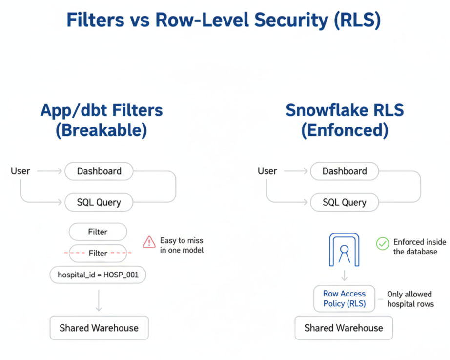
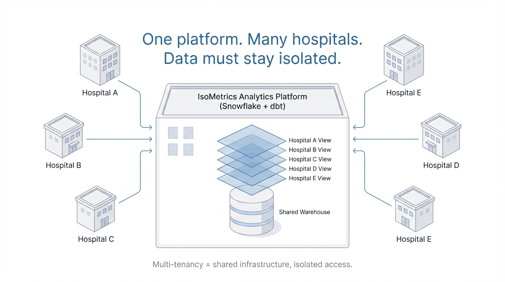
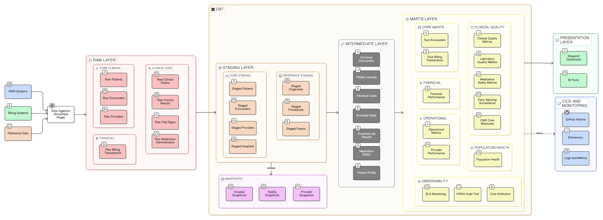
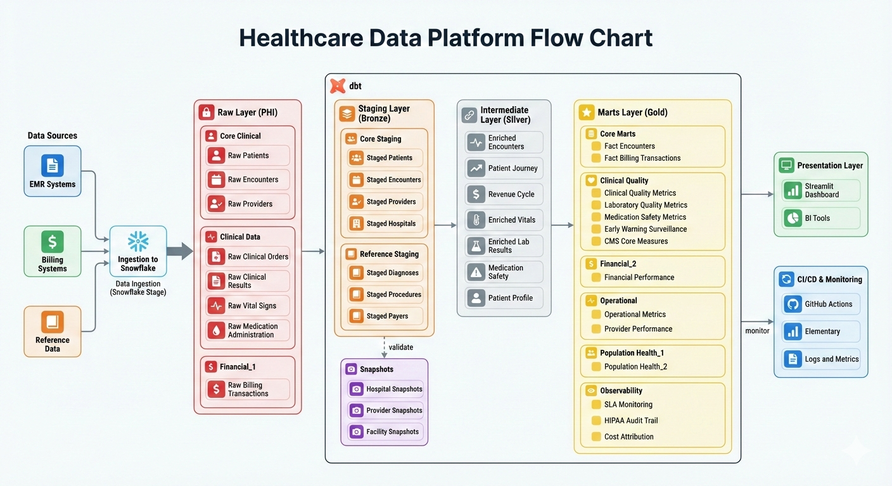
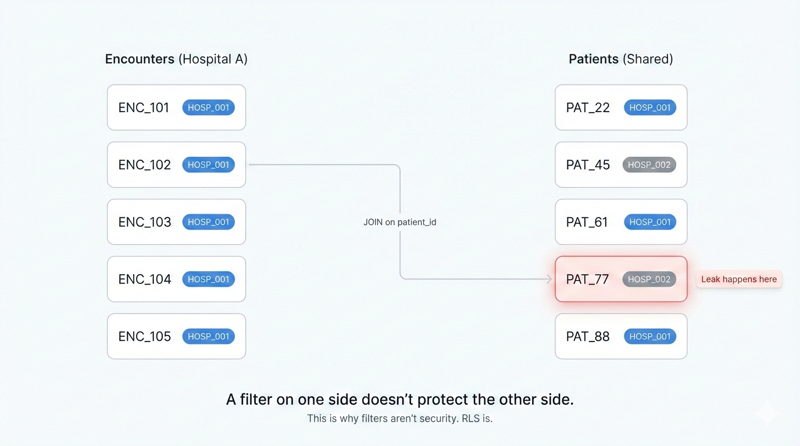
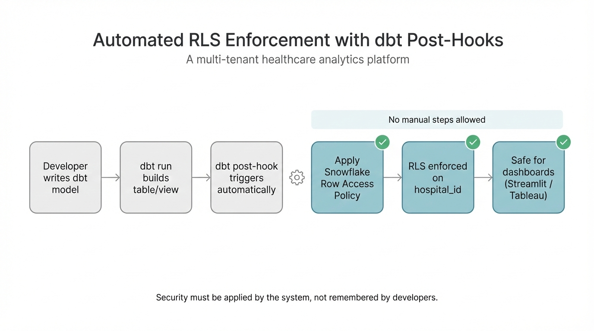
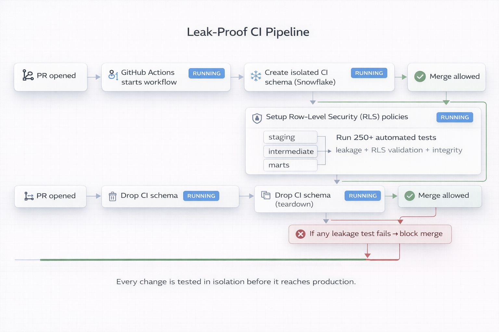
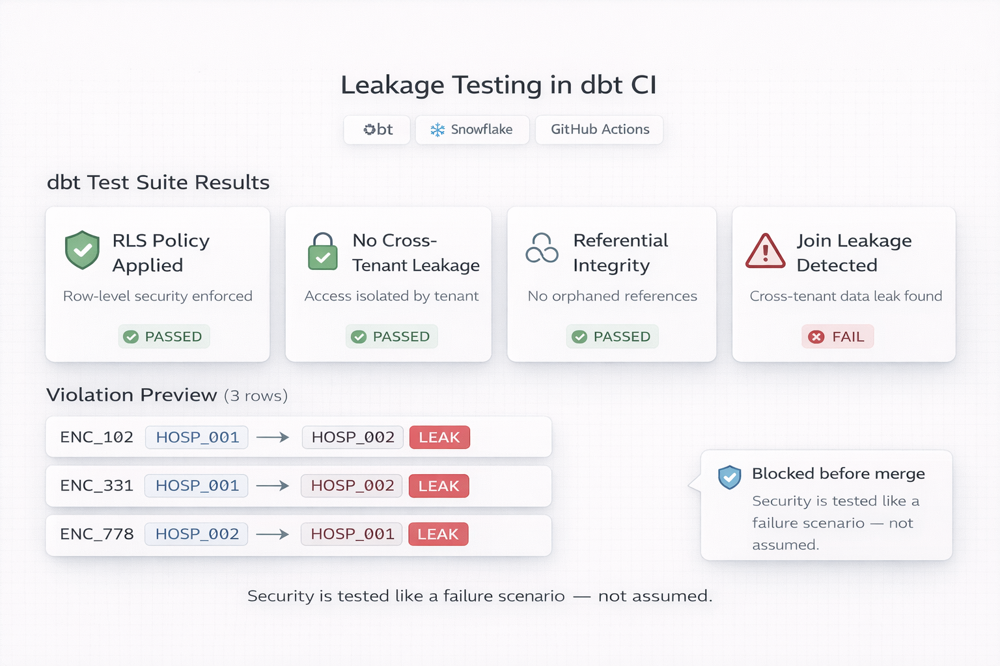

# dbt in Healthcare: How I Enforced Row-Level Security in Snowflake to Prevent Cross-Hospital Data Leaks

## Why RLS Matters: One Leaked Row Can Kill Your Platform

### The Danger of Multi-Tenant Systems

All customers share the same tables. Hospital A's data sits in the same `encounters` table as Hospital B's data. You separate them with a `hospital_id` column. That's it. One table, 50 tenants, millions of rows mixed together.

**The entire system relies on never showing Hospital A any row where `hospital_id = 'HOSPITAL_B'`.**

Most platforms handle this with `WHERE hospital_id = {current_user_hospital}` filters in their application layer or dbt models. **This is not security. This is a suggestion.**

### The First Leak is Never "Minor"

When someone discovers they can see another tenant's data—even one row—it proves:

- **Tenant isolation isn't guaranteed.** If it leaked once, it can leak again.
- **The security model has gaps.** Which other gaps exist?
- **Trust evaporates instantly.** Would you trust a bank that "accidentally" showed you someone else's account?

In healthcare specifically, one leaked row can expose:

- Patient identifiers (Medical Record Numbers)
- Diagnosis codes (status, mental health conditions)
- Admission dates (when someone was hospitalized)
- Financial data (insurance, charges)

That's not "oops, sorry" territory. That's breach notification letters, regulatory investigations, and contract terminations.

### Common Causes of the First Leak

**1. Relying on WHERE filters**

```sql
-- This is NOT security 
SELECT * FROM encounters 
WHERE hospital_id = 'HOSP_001'
```

What happens when:
- Someone queries the table directly?
- A junior engineer forgets the filter?
- A JOIN accidentally drops the condition?

**2. dbt Security Drift**

You create 50 models. All have proper filters. Then:
- Engineer creates model #51, forgets the filter
- CI tests pass (tests don't check isolation)
- Deploy happens
- Leak exists in production

### The Correct Answer: Enforcement at the Database Layer

**Filters are suggestions. Row-Level Security is enforcement.**

This is the foundation everything else builds on.

---

## Key Concepts Explained

- **Multi-tenancy:** One software system serves many customers (tenants) using shared infrastructure. Like an apartment building—many tenants, one building, separate spaces.

- **Tenant isolation:** Each customer's data stays completely separated from other customers' data. Hospital A cannot see Hospital B's patients, ever.

- **HIPAA (Health Insurance Portability and Accountability Act):** A US healthcare privacy law that sets strict rules for protecting patient data. Breaking HIPAA can lead to heavy fines and legal trouble.

- **PHI (Protected Health Information):** Medical data covered by HIPAA regulations. Patient names, diagnoses, dates of service, medical record numbers. Leaking PHI = serious legal consequences.

- **RLS (Row-Level Security):** Database-level security that automatically filters rows based on who's querying. Snowflake says "you can only see rows that belong to you" before the data even leaves the database.

- **dbt models:** SQL transformations that build data tables. Instead of manually running `CREATE TABLE … SELECT …`, you write SQL in files and dbt handles the execution, testing, and documentation.

- **CI pipeline (Continuous Integration):** Automated testing that runs every time code changes. Before merging your PR, robots run 250+ tests to ensure nothing breaks.

---

## The Real Problem with WHERE Filters



Most platforms secure multi-tenant data like this:

```sql
WHERE hospital_id = session.current_hospital
```

This breaks in real life for three reasons:

### Example 1: The Forgotten Filter

```sql
-- Engineer writes a new dashboard query
SELECT 
  COUNT(*) as total_readmissions,
  AVG(length_of_stay) as avg_los
FROM encounters
WHERE is_readmission = TRUE
-- Oops, forgot WHERE hospital_id = X
-- Query shows ALL hospitals aggregated together
```

Data from Hospital A leaks into Hospital B's dashboard. Nobody notices until an audit.

### Example 2: The Drift Over Time

- **Month 1:** 20 dbt models, all have proper filters
- **Month 6:** 50 models
- **Month 12:** 100 models

Someone creates `fct_clinical_alerts.sql`. They copy-paste from an old model. That old model predated the security requirements. No `hospital_id` filter. **Leak in production.**

### Why Enforcement Beats Filtering

With Row-Level Security at the database layer:

```sql
-- Engineer writes sloppy query:
SELECT * FROM encounters;

-- Snowflake intercepts and rewrites it to:
SELECT * FROM encounters 
WHERE hospital_id IN (
  SELECT hospital_id 
  FROM user_hospital_mapping 
  WHERE user_name = CURRENT_USER()
);
```

The database enforces isolation. Not the application. Not the engineer's memory. **The database.**

Even if someone hacks into Snowflake directly and runs raw SQL, they still can't see other hospitals' data. That's enforcement.

---

## What I Built: One Platform, Many Hospitals



**IsoMetrics Healthcare** is a multi-tenant SaaS analytics platform for hospital performance monitoring. Think: "Salesforce analytics for hospitals."

- **Scale:** 50 hospital tenants, 3M+ encounters, 500K+ transactions
- **Architecture:** Medallion (Bronze → Silver → Gold) with 50+ dbt models
- **Security:** Snowflake RLS + HIPAA audit trail
- **Operations:** Streamlit monitoring, GitHub Actions CI/CD
- **Requirements:** Zero cross-tenant leakage, 4-hour freshness SLA, per-tenant cost tracking

---

## Architecture Walk-through: Medallion + Security + Monitoring




### Key Points

1. **Every schema has RLS applied** - from raw data to final marts
2. **`hospital_id` is the isolation key** - present in every table
3. **Audit schema tracks everything** - who accessed what, when
4. **Monitoring sits on top** - real-time SLA/quality/cost visibility

---

## RLS in Snowflake: The "Easy" Part

Snowflake Row-Level Security works like this:

### Step 1: Create a Mapping Table

```sql
CREATE TABLE user_hospital_mapping (
  user_name VARCHAR,
  hospital_id VARCHAR,
  access_reason VARCHAR
);

INSERT INTO user_hospital_mapping VALUES
  ('analyst@hospital-a.com', 'HOSP_001', 'Employee'),
  ('analyst@hospital-b.com', 'HOSP_002', 'Employee'),
  ('admin@platform.com', 'ALL', 'Platform Admin');
```

This defines: **who can see which hospital's data.**

### Step 2: Create the RLS Policy

```sql
CREATE ROW ACCESS POLICY hospital_isolation_policy
AS (hospital_id VARCHAR) RETURNS BOOLEAN ->
  CASE
    -- Admins see everything
    WHEN CURRENT_ROLE() = 'ACCOUNTADMIN' THEN TRUE
    
    -- Regular users see only their hospital
    WHEN EXISTS (
      SELECT 1 FROM user_hospital_mapping
      WHERE user_name = CURRENT_USER()
        AND hospital_id = hospital_id -- ⚠️ BUG: both sides resolve to the mapping column
    ) THEN TRUE
    
    -- Default deny
    ELSE FALSE
  END;
```

**What this does:**

- Checks who is querying (`CURRENT_USER()`)
- Looks them up in `user_hospital_mapping`
- Returns `TRUE` only for rows matching their allowed `hospital_id`
- **Default deny:** if not explicitly allowed, block the row

> ⚠️ **Don't copy this one.** Inside the subquery, the unqualified `hospital_id` on
> *both* sides binds to `user_hospital_mapping.hospital_id`, not to the policy
> argument. The comparison is always true, so any mapped user sees every hospital.
> This exact bug shipped in this project's first policy. The fix is in
> [The Clean Implementation](#snowflake-rls-the-clean-implementation) below.

### Step 3: Apply Policy to Tables

```sql
ALTER TABLE encounters 
  ADD ROW ACCESS POLICY hospital_isolation_policy 
  ON (hospital_id);

ALTER TABLE patients 
  ADD ROW ACCESS POLICY hospital_isolation_policy 
  ON (hospital_id);
```

Now when anyone queries those tables, Snowflake automatically filters rows based on the policy.

**Example:**

```sql
-- User: analyst@hospital-a.com
SELECT * FROM encounters;

-- Snowflake internally rewrites this to:
SELECT * FROM encounters
WHERE hospital_id IN (
  SELECT hospital_id FROM user_hospital_mapping
  WHERE user_name = 'analyst@hospital-a.com'
);
-- Returns only HOSP_001 rows
```

**The power:** even if the analyst runs `SELECT *` with no filters, they only see their hospital. The database enforces it.

### This is the "Easy" Part

Creating one policy and applying it to one table is straightforward. The hard part comes when you have:

- 50+ dbt models generating new tables constantly
- Models created by different engineers over months
- Incremental materializations that rebuild tables
- CI/CD pipelines creating temporary schemas

**How do you guarantee every model, everywhere, always has RLS applied?**

That's where most platforms fail.

---

## Where It Gets Hard: dbt + Multi-Tenancy

dbt is a transformation framework. You write SQL models like this:

```sql
-- models/marts/fct_encounters.sql
SELECT 
  encounter_id,
  hospital_id,
  patient_id,
  admission_date,
  length_of_stay
FROM {{ ref('stg_encounters') }}
WHERE discharge_date IS NOT NULL
```

dbt runs this SQL and creates a table `fct_encounters` in Snowflake.

**The problem:** dbt creates tables. RLS policies apply to tables. Who ensures the policy gets applied?

### Why dbt Increases RLS Risk



**Risk 1: New models forget RLS**

Engineer creates `fct_provider_performance.sql`. They test it. It works. They merge the PR. It deploys.

Nobody remembered to apply the RLS policy to `fct_provider_performance`. **Leak exists in production.**

**Risk 2: Incremental models recreate tables**

```sql
# models/marts/fct_encounters.sql
{{ config(
  materialized='incremental',
  unique_key='encounter_id'
) }}
```

When dbt runs incrementally, it sometimes recreates the entire table (depending on schema changes). When the table is recreated, Snowflake drops the RLS policy. You have to reapply it.

If you forget? **Leak.**

**Risk 3: dbt security drift over time**

- **Month 1:** 20 models, all have RLS
- **Month 3:** 35 models, 2 missing RLS (nobody noticed)
- **Month 6:** 50 models, 5 missing RLS
- **Month 12:** 100 models, 15 missing RLS

Security degrades silently because there's no enforcement mechanism.

### The Manual Approach Fails

"Just remember to apply RLS after creating each model."

This doesn't scale. Engineers forget. New hires don't know the rule. Automated dbt runs don't include manual steps.

**You need automation that makes it impossible to deploy a model without RLS.**

---

## Snowflake RLS: The Clean Implementation

### Step 1: Mapping Table (Who Can See What)

```sql
CREATE OR REPLACE TABLE security.user_hospital_mapping (
  user_name STRING,
  hospital_id STRING,
  access_reason STRING
);

INSERT INTO security.user_hospital_mapping VALUES
  ('analyst@hospital-a.com', 'HOSP_001', 'Hospital Employee'),
  ('analyst@hospital-b.com', 'HOSP_002', 'Hospital Employee');
```

This is the simplest, most auditable foundation: **explicit allow list.**

### Step 2: Row Access Policy (Default Deny)

This version is intentionally written to avoid ambiguous naming:

```sql
CREATE OR REPLACE ROW ACCESS POLICY security.hospital_isolation_policy
AS (row_hospital_id STRING)
RETURNS BOOLEAN ->
  EXISTS (
    SELECT 1
    FROM security.user_hospital_mapping m
    WHERE m.user_name = CURRENT_USER()
      AND m.hospital_id = row_hospital_id
  );
```

**Why this is correct:**

- `row_hospital_id` clearly represents the table row's tenant
- No accidental `hospital_id = hospital_id` logic
- Users only see rows they are mapped to

### Step 3: Apply to Tenant-Scoped Tables

```sql
ALTER TABLE marts.encounters
  ADD ROW ACCESS POLICY security.hospital_isolation_policy
  ON (hospital_id);

ALTER TABLE marts.patients
  ADD ROW ACCESS POLICY security.hospital_isolation_policy
  ON (hospital_id);
```

Now tenant isolation is enforced at query time for every user.

---

## The Real Challenge: dbt + RLS = Policy Drift

RLS is easy to apply to 2 tables.

The real issue is scale:

- 50+ dbt models
- New models every week
- Incremental rebuilds
- CI schemas and preview environments

**This is where systems fail:**

- A new table ships without RLS
- A rebuild drops security
- Nobody notices until leakage happens

**So I removed the human step entirely.**

---

## How I Enforced RLS Across All dbt Models (Automatic + Safe)



### Step 1: dbt Macro That Applies RLS Only When Needed

```sql
-- macros/apply_rls_policy.sql (simplified)

  
    
    

    {# real-time lookup; ACCOUNT_USAGE lags by up to 2 hours #}
    

    
      
    
      
    
  

```

**What this solves:**

- Tenant-scoped tables and views always get RLS (`ALTER VIEW` vs `ALTER TABLE` by materialization)
- **Idempotent:** incremental tables keep their policy between runs. The first
  version of this macro blindly ran `ADD ROW ACCESS POLICY` and failed on the second
  incremental run.
- A conflicting policy fails the build instead of being silently ignored
- No "remember to apply security" step exists anymore

### Step 2: Attach It to Every Tenant-Scoped Model

```sql
-- every staging and mart model with a hospital_id
{{ config(post_hook=["{{ apply_rls_policy() }}"]) }}
```

Intermediate models are `ephemeral`: they're compiled into the marts as CTEs and
never exist in the warehouse, so there's nothing to attach a policy to. Reference
lookups (ICD-10, CPT, payers) have no `hospital_id` and no hook.

A per-model hook can still be forgotten, so the guarantee comes from a test
rather than from convention. `assert_rls_policy_applied` walks the dbt graph and
fails if *any* staging or mart model lacks the policy (Test 2 below).

**Result:**

1. Engineer creates a new model
2. dbt builds it
3. Post-hook attaches RLS, or the RLS test fails and blocks the deploy

**No PR can accidentally introduce an unsecured tenant table.**

---

## Leak-Proof CI: Testing Like an Attacker



CI (Continuous Integration) is your safety net. Before code reaches production, robots run tests to find bugs.

For multi-tenant systems, **CI must test like an attacker trying to steal data.**

### The CI Pipeline Structure

**Step 1: Every PR gets an isolated schema**

```yaml
# .github/workflows/dbt_ci.yml
env:
  CI_SCHEMA: dbt_ci_${{ github.event.pull_request.number }}
```

- PR #47 runs in schema `dbt_ci_47`
- PR #48 runs in schema `dbt_ci_48`

**Why isolation matters:**

- Tests don't interfere with each other
- You can test dangerous scenarios safely
- Cost control: destroy schema after tests pass

**Step 2: Point at synthetic data**

```yaml
# .github/workflows/dbt_ci.yml
env:
  DBT_RAW_DATABASE: ISOMETRICS_DEV   # sources read the synthetic RAW_PHI tables
```

CI builds every model into its own schema from the synthetic dev data. That data
has many hospitals with overlapping volumes, so a join that crosses tenants shows
up in the leak tests below.

**Step 3: Run dbt**

```bash
dbt run --select staging
dbt run --select intermediate 
dbt run --select marts
```

**Step 4: Run leak detection tests**

This is where it gets interesting.



### Test 1: Cross-Tenant Leakage Detection

```sql
-- tests/singular/assert_no_cross_hospital_encounters.sql
SELECT
  e.encounter_id,
  e.hospital_id AS encounter_hospital,
  p.hospital_id AS patient_hospital
FROM {{ ref('stg_encounters') }} e
JOIN {{ ref('stg_patients') }} p
  ON e.patient_id = p.patient_id
WHERE e.hospital_id != p.hospital_id
```

**What this catches:**

- Hospital A encounter linked to Hospital B patient
- Proves tenant boundaries were violated during a JOIN

**If this returns ANY rows, the test fails. Deploy blocked.**

### Test 2: RLS Policy Verification

```sql
-- tests/singular/assert_rls_policy_applied.sql (simplified)

  select '{{ node.name }}' as model_name,
         count_if(policy_name = 'HOSPITAL_ISOLATION_POLICY') as rls_policy_count
  from table(information_schema.policy_references(
      ref_entity_name => '{{ node.relation_name }}',
      ref_entity_domain => '{{ "view" if node.config.materialized == "view" else "table" }}'))
  union all

-- outer query: return rows where rls_policy_count = 0
```

**What this catches:**

- A new model was created without RLS
- RLS was accidentally dropped

Two lessons are built into this version:

- The first version filtered `information_schema.tables` on `table_schema = 'MARTS'`.
  dbt actually builds into `<target>_MARTS` (`DBT_DEV_MARTS`, `DBT_CI_47_MARTS`), so
  it checked *zero* tables and always passed. Deriving the list from the dbt graph
  means it checks exactly what the current target built.
- It used `ACCOUNT_USAGE.POLICY_REFERENCES`, which lags by up to 2 hours: useless
  for checking a table built 30 seconds ago in CI. The `INFORMATION_SCHEMA` table
  function is real-time.

**If ANY staging or mart model is missing RLS, deploy blocked.**

### Bonus Tests

**Test 3: Foreign key integrity within tenants**

- Hospital A encounter references Hospital B provider
- Referential integrity violation across tenant boundaries

**Test 4: Clinical safety rules**

- Test data accidentally has a patient receiving a medication they're allergic to
- Health scores, metrics tests

**Step 5: Teardown (cost control)**

```sql
-- After tests pass/fail
DROP SCHEMA IF EXISTS dbt_ci_47 CASCADE;
```

**Why this matters:**

- CI schemas can accumulate
- Each schema costs money if left running
- Cleanup after every PR prevents cost bloat

### The Result

Before code merges:

- ✅ 250+ tests run
- ✅ Leakage scenarios tested
- ✅ RLS verified on all tables
- ✅ Foreign keys checked
- ✅ Clinical safety validated

**If ANY test fails, deploy blocked.**

This is what "leak-proof CI" means. You're not hoping security works. You're proving it works before production.

---

## Incremental Models: Performance Without Corruption

Let's talk about a subtle problem that silently destroys data correctness: **wrong incremental strategy.**

### What "Incremental" Means

```sql
-- Normal dbt model:
-- Runs every time: DROP TABLE, CREATE TABLE, INSERT ALL DATA
SELECT * FROM source_table

-- Incremental model:
-- First run: INSERT ALL DATA
-- Future runs: INSERT/UPDATE only NEW/CHANGED data
SELECT * FROM source_table
WHERE updated_at > (SELECT MAX(updated_at) FROM {{ this }})
```

**Why incremental matters:**

- 3M encounters = expensive full refresh every run
- Incremental = faster, cheaper, less warehouse load

### The Danger: Wrong Strategy Silently Corrupts Data

dbt supports multiple incremental strategies:

**1. `append` (add new rows only)**

- **When to use:** Audit logs, event streams (data never changes, only new events arrive)
- **What breaks:** If source data can UPDATE (like billing status changing from "Pending" to "Paid"), append strategy never updates existing rows. You have stale data forever.

**2. `delete+insert` (delete partition, insert fresh data)**

- **When to use:** High-volume fact tables where data rarely changes after initial load (encounters, claims)
- **How it works:**
  1. Identify changed rows by `unique_key`
  2. Delete those rows
  3. Insert fresh versions
- **Performance:** Very fast because it doesn't scan the entire table for matches (like MERGE does)

**3. `merge` (UPDATE existing, INSERT new)**

- **When to use:** Data that frequently changes (billing transactions changing status, patient demographics updating)
- **How it works:**

```sql
MERGE INTO target
USING source
ON target.id = source.id
WHEN MATCHED THEN UPDATE SET …
WHEN NOT MATCHED THEN INSERT …
```

- **Cost:** Slower because Snowflake scans both tables to find matches

### The Gotcha I Learned the Hard Way

I initially used `append` for billing transactions because "we're just adding new billing records."

**Wrong.**

Billing records change status: "Pending" → "Paid", "Denied" → "Approved". With `append`, old status never updated. Dashboard showed incorrect payment rates. **Silent data corruption.**

**Fix:** Switch to `merge` strategy. Now status updates propagate correctly.

### Clustering Matters for Incremental Performance

```sql
{{ config(
  cluster_by=['hospital_id', 'admission_date']
) }}
```

**Why cluster on `hospital_id`:**

- Multi-tenant = every query filters by hospital
- Clustering puts each hospital's data physically together
- Snowflake skips irrelevant micro-partitions
- 10x query speedup on large tables

**Why cluster on date:**

- Most queries filter recent data ("last 30 days")
- Date clustering = skip old partitions
- Incremental runs faster (only scan recent partitions)

### Takeaway

- `append` = fastest but dangerous if data updates
- `delete+insert` = good balance for mostly-static data
- `merge` = slower but required if data changes frequently
- Full refresh = too expensive for 3M+ rows

**Choose based on your data's behavior, not speed alone.**

---

## Monitoring: Freshness + Quality + Access + Cost

You've built a secure, high-performance multi-tenant platform. How do you know it's working?

### The Streamlit Monitoring Dashboard

I built a Streamlit dashboard showing:

**1. SLA Freshness**

```sql
SELECT 
  hospital_id,
  MAX(loaded_at_timestamp) AS last_load,
  DATEDIFF('minute', last_load, CURRENT_TIMESTAMP()) AS freshness_minutes
FROM staging.stg_encounters
GROUP BY hospital_id
```

**SLA target:** Data fresh within the tenant requirements.

Dashboard shows:

- ✅ **Compliant:** < 240 minutes
- ⚠️ **Warning:** 240–360 minutes
- 🚨 **Breach:** > 360 minutes

**Why this matters:** Stale data hiding behind "pipeline green" is dangerous. Freshness SLA surfaces this immediately.

**2. Data Quality Score**

```sql
SELECT
  hospital_id,
  COUNT(*) AS total_encounters,
  SUM(CASE WHEN length_of_stay < 0 THEN 1 ELSE 0 END) AS invalid_los,
  SUM(CASE WHEN discharge_date < admission_date THEN 1 ELSE 0 END) AS invalid_dates,
  100.0 * (total_encounters - invalid_los - invalid_dates) / total_encounters AS quality_pct
FROM marts.fct_encounters
GROUP BY hospital_id
```

Dashboard shows:

- Quality score per hospital
- Breakdown of validation failures
- Trend over time

**Why this matters:** Incremental models can silently accumulate bad data. Quality scoring catches this before users complain.

**3. HIPAA Audit Trail**

```sql
SELECT
  access_timestamp,
  user_name,
  role_name,
  phi_tables_accessed,
  records_accessed,
  is_unauthorized,
  compliance_note
FROM marts.fct_hipaa_audit_trail
WHERE access_timestamp >= DATEADD('day', -7, CURRENT_DATE())
ORDER BY access_timestamp DESC
```

**What this tracks:**

- Every query accessing PHI tables
- Which user, what role, when
- Unauthorized access attempts (blocked by RLS but logged)

**Why this matters:** HIPAA requires audit trails. This proves who accessed what patient data and why.

**4. Per-Tenant Cost Attribution**

```sql
-- fct_cost_attribution (excerpt): attribute each query to a hospital
SELECT
  COALESCE(
    REGEXP_SUBSTR(query_text, 'hospital_id\\s*=\\s*[\'"]([A-Z0-9_]+)[\'"]', 1, 1, 'ie', 1),
    'UNATTRIBUTED') AS hospital_id,
  DATE_TRUNC('day', start_time) AS day,
  SUM(total_elapsed_time) / 1000 AS execution_seconds
FROM snowflake.account_usage.query_history
WHERE database_name = CURRENT_DATABASE()
GROUP BY 1, 2
-- warehouse credits (WAREHOUSE_METERING_HISTORY) are then split across
-- hospitals in proportion to execution time
```

Limitation: a query scoped only by the row access policy has no `hospital_id`
predicate and lands in `UNATTRIBUTED`. Tagging sessions with the tenant
(`QUERY_TAG`) would be more reliable.

Dashboard shows:

- Cost per hospital per day
- Warehouse usage trends
- Expensive queries

**Why this matters:** Multi-tenant platforms need fair cost allocation. High-usage hospitals should potentially pay more.

### Real-Time Alerts

The dashboard also triggers alerts:

```python
# Streamlit alerting logic
if freshness_minutes > 360:  # 6 hours
    st.error("🚨 SLA BREACH: Data is 6+ hours stale")

if unauthorized_access_count > 0:
    st.error("🚨 SECURITY ALERT: Unauthorized PHI access detected")

if quality_score < 95:
    st.warning("⚠️ DATA QUALITY: Score below 95%")
```

Engineers see these alerts immediately. No waiting for weekly reports to discover problems.

---

## Tech Stack & Performance Optimization

### Core Technologies

**Data Platform:**

- **Snowflake:** Multi-cluster warehouses (XSMALL for dev, SMALL for prod), time travel, zero-copy cloning
- **dbt 1.11:** Jinja templating, incremental materializations, snapshot histories, macro libraries
- **Python 3.11:** Synthetic data generation with Faker, Pandas for transformations
- **Streamlit:** Real-time monitoring dashboard with Plotly visualizations

**DevOps & CI/CD:**

- **GitHub Actions:** Automated testing on every PR, isolated CI schemas per branch
- **SnowSQL:** Schema provisioning, RLS policy deployment, cleanup automation

**Security & Compliance:**

- **Snowflake RLS:** Database-enforced tenant isolation, policy-based access control
- **Account Usage Views:** HIPAA audit trail construction, query history analysis

### Performance Optimization

**Key strategies:**

- **Clustering:** Clustered fact tables by `(hospital_id, admission_date)` to speed up tenant + recent-date queries
- **Incremental models:** Used the right strategy per table (append for logs, delete+insert for stable high-volume tables, merge for frequently updated tables)
- **Warehouse sizing:** Enabled auto-suspend/auto-resume and used smaller warehouses for dev/CI to control compute cost
- **Query tuning:** Filtered by tenant + date early (before joins) to reduce scanned data and improve join performance

---

## What I Learned

- **RLS can vanish:** dbt table recreation can drop Snowflake RLS silently, so I reapply it using post-hooks
- **Wrong incremental strategy breaks data:** Using append for changing records caused stale statuses, so I switched to merge for correctness
- **CI must catch leakage:** Tests should validate no cross-tenant joins, not just "table exists"
- **Green pipeline ≠ fresh data:** Added freshness/SLA checks to detect stale loads early

---

## Why This Matters for Real-World Systems

This architecture pattern applies beyond healthcare analytics:

### 1. Multi-Tenant SaaS Platforms (Salesforce, Workday, etc.)

- Same isolation requirements (customer A can't see customer B)
- Same RLS enforcement needs
- Same CI testing complexity

### 2. Financial Data Platforms (FinTech, Banking)

- Account-level isolation instead of hospital-level
- Similar audit trail requirements (SOC 2, PCI-DSS)
- Similar cost attribution needs

### 3. IoT/Device Analytics (Manufacturing, Logistics)

- Device-level or factory-level isolation
- High-volume incremental ingestion (sensors generating data constantly)
- Same clustering optimization patterns

### 4. Any Data Platform With:

- Multiple customers sharing infrastructure
- Regulatory compliance requirements (HIPAA, SOC 2, GDPR)
- Need for tenant-level cost visibility
- Performance requirements (sub-second queries on billions of rows)

### The Patterns Transfer

- RLS automation via dbt post-hooks
- Incremental strategy selection matrix
- Clustering on `tenant_id` + `time_column`
- CI tests proving isolation works

---

## Design Trade-offs & Limitations

No architectural decision is free. This platform deliberately optimizes for **consistency, correctness, and operational simplicity** over absolute portability or lowest cost.

### 1. Snowflake Vendor Lock-In

**What I gained:**

- Zero-copy cloning for CI environments (instant schema duplication)
- Native RLS enforcement without application-layer complexity
- Automatic clustering and micro-partition pruning
- Account Usage views for audit trails

**Why I chose this:** Multi-tenant RLS that actually works is harder than it looks. Building application-layer isolation is:

- 10x more code to maintain
- 100x more security surface area
- Guaranteed to have bugs

Snowflake's RLS is database-enforced. Even if someone hacks in and runs raw SQL, they can't bypass it. That's worth vendor lock-in.

**Bottom line:** Security correctness > portability.

### 2. dbt-Centric Architecture

**What I gained:**

- Version-controlled transformations (every change in Git)
- Automated testing framework (250+ tests on every PR)
- Documentation generation (lineage graphs, column descriptions)
- Incremental materializations (6s vs. 4m for 3M rows)

**Why I chose this:** For analytics workloads (not operational dashboards), batch is sufficient. Requirements:

- Data fresh within 4 hours (not 4 seconds)
- Correctness > speed (especially in healthcare systems)
- Testing infrastructure > rapid deployment

dbt's testing framework catches cross-tenant leaks before production. That's more valuable than sub-second freshness.

**Bottom line:** Batch + testing > streaming + bugs.

### 3. Macro-Based RLS Automation Over Manual Application

**What I gained:**

- Zero manual steps (engineer creates model → RLS auto-applied)
- Consistent enforcement (impossible to deploy without RLS)
- Visible in logs (see confirmation in dbt output)
- Fails loudly (missing policy = build fails)

**Why I chose this:** Security through automation > security through discipline.

Manual RLS application fails because:

- Engineers forget
- New hires don't know the rule
- Automated dbt runs have no "manual step" mechanism

**Bottom line:** Automation guarantees enforcement > manual steps guarantee eventual failure.

### Trade-off Summary

| Dimension   | Optimized For                   | Traded Away            |
|-------------|---------------------------------|------------------------|
| Security    | Database-enforced isolation     | Platform portability   |
| Correctness | Comprehensive testing           | Real-time latency      |
| Compliance  | Synthetic test data             | Production realism     |
| Simplicity  | Snowflake native features       | Vendor independence    |
| Reliability | Automation over discipline      | Manual control         |

### Would I Make Different Choices for Different Requirements?

**Yes:**

- **Operational dashboards (sub-second latency required):** Choose streaming architecture (Kafka + Flink)
- **Cost-constrained (minimizing spend > feature velocity):** Choose BigQuery (5x cheaper per query)
- **Multi-cloud portability (must run on AWS/Azure/GCP):** Choose Databricks (cloud-agnostic)

**But for healthcare analytics SaaS:**

- Correctness and compliance > cost
- Testing infrastructure > rapid deployment
- Database-enforced security > application-layer complexity

These trade-offs optimize for systems that can't afford to be wrong.

---

## The Real Lesson: Multi-Tenancy is a Security + Automation Discipline Problem

Building a multi-tenant analytics platform taught me this:

### Filters Are Not Security. They're Suggestions.

The only real security is database-level enforcement that works even when:

- Engineers forget
- Queries are sloppy
- JOINs cross boundaries
- Someone hacks in and runs raw SQL

### Automation is Not Optional. It's the Foundation.

You cannot rely on:

- "Remember to apply RLS"
- "Don't forget the WHERE clause"
- Manual checklists
- Engineers being careful

You need:

- **dbt automation** (post-hooks applying RLS automatically)
- **CI testing** (250+ tests proving isolation works)
- **Real-time monitoring** (freshness, quality, access, cost)

### One Leaked Row Kills Your Platform

Not "minor bug." Trust destroyed, contracts voided, compliance violations filed.

In healthcare, that row might expose PHI. That's not a data leak. That's a HIPAA incident. That's end-of-company territory.

---

## Final thought

Multi-tenant systems are inherently dangerous because all customers share infrastructure. The discipline required to make them secure is higher than single-tenant systems.

If you're building one:
- Enforce isolation at the database layer (RLS, not filters)
- Automate security (dbt hooks, not manual steps)
- Test like an attacker (cross-tenant leakage scenarios in CI)
- Monitor in real-time (freshness, quality, violations, cost)

Do these four things, and you can sleep at night.

Skip any of them, and you're one query away from disaster.

---

Explore the Full Implementation
GitHub Repository: https://github.com/Pathakdarshan12/Isometrics-Healthcare-Multi-Tenant-SaaS-Analytics-Platform
What's included:
- **Architecture & Design**
- **Security Implementation**
- **Performance Optimizations**
- **Testing Framework**
- **GitHub Actions CI/CD pipeline with isolated testing schemas**
- **Monitoring Dashboard:**

---

## Let's Connect
If you're building data platforms, dealing with multi-tenant security complexity, or evaluating data engineering candidates, I'd love to discuss:

Multi-tenant isolation strategies beyond basic WHERE filters

dbt testing frameworks that actually catch bugs before production
**Incremental materialization** performance tuning (when MERGE kills you)
**Security automation patterns** (making it impossible to deploy insecure code)
**Healthcare analytics** architecture (HIPAA compliance without sacrificing performance)

LinkedIn: [Connect with me](https://www.linkedin.com/in/pathakdarshan12/)